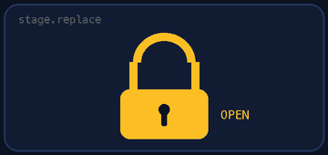
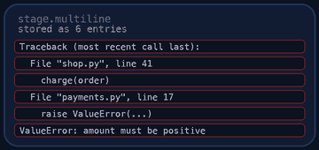
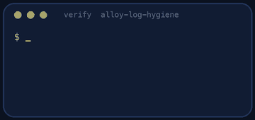
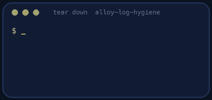

<p align="center"></p>

| | |
|-|-|
| **Time** | 90-105 min |
| **Cost** | free on your own machine |
| **You need** | Docker with Compose v2, curl, Python 3 and a terminal (on Windows use WSL) |

## How this lab works

1. **Fork** this repository to your own GitHub account (button at the top right).
2. Clone **your fork** in your Ubuntu environment (WSL on Windows, your OrbStack machine on Mac).
3. Read the lab below (the same text is in [`LAB.md`](LAB.md)) and follow the mission.
4. Answer the questions in [`SUBMISSION.md`](SUBMISSION.md). Where a question asks for output, paste it in a code block. No screenshots needed.
5. Commit and push. Open the **Actions** tab of your fork (click *I understand my workflows, go ahead and enable them* the first time). The **Lab check** shows what is still missing.
6. When the check is green, **submit the URL of your fork** in the course platform.

> [!NOTE]
> The check only looks at your answers and any files the lab asks you to commit. Your instructor reads your work and may ask you to explain any line.

<p align="center"></p>

## 🎬 The situation

<p align="center"></p>

You have just joined the platform team of a cafe franchise. On your second day the data-protection officer forwards you a short message that landed in the inbox:

> *"We searched our log store for the word `@`. It returned 40,000 customer e-mail addresses, next to card numbers and a login token. Please tell me this is a test environment."*

It is not. And finance adds a second finding, quieter but just as real: half of what the company pays for log storage is health checks and debug chatter. Developers add a third: every stack trace arrives as six separate lines that nobody can search as one error.

Logs are cheap to write and expensive to forget. The place to fix all three problems is the **pipeline**, between the application and the store, *before* anything is written down. Grafana **Alloy** is that pipeline. Take your time: this lab is a careful walk, one stage at a time, and every stage answers one of the three findings.

> [!IMPORTANT]
> **Your mission**
> - Read what the shop really writes, before you change anything
> - Build an Alloy pipeline: read only the shop, glue stack traces, drop the noise, redact the secrets, keep the labels few
> - Prove from Loki itself that the stored data is clean
> - Explain in `PRIVACY.md` what you removed and what the better fix at the source would be
> - Tear down and prove it

**Time:** 90-105 min | **Cost:** free on your own machine | **You need:** Docker with Compose v2, curl, Python 3 and a terminal (on Windows use WSL)

<p align="center"></p>

## Part 0 - Start the noisy shop

Fork this repository, clone your fork and run:

```bash
./setup.sh
```

It starts a small shop service that logs far too much (the container is `hygiene-shop`) and a Loki log store on port `3197`. Alloy is defined but it has an empty pipeline: nothing flows yet.

<p align="center"></p>

## Part 1 - Recon: read the raw logs like a stranger

<p align="center"></p>

Before you write one line of configuration, look at what the shop writes:

```bash
docker logs hygiene-shop | head -40
```

Make a list in your notes. For each kind of line, write: how often it appears, whether it is useful, and whether it is dangerous.

- Which lines look like noise? (Count how many per minute: `docker logs --since 1m hygiene-shop | wc -l`.)
- Where do you find personal data? Find **three kinds**. Copy one real example of each.
- What does one error look like? How many physical lines is it?

> [!NOTE]
> **Predict** Your pipeline will read the container's stdout line by line. A Python traceback is several lines. If you do nothing about it, how many entries will Loki store for one error: one, or one per line? Write your answer, then check it in Part 5.

<p align="center"></p>

## Part 2 - The skeleton: read only the shop

Open `alloy/config.alloy`. The comments are your assignment. Start with the smallest working pipeline and grow it, because a pipeline you can run is a pipeline you can debug:

1. `discovery.docker`, `discovery.relabel` and `loki.source.docker`: read **only** the container named `hygiene-shop`, and give every line one static label `service="shop"`.
2. `loki.write` to `http://loki:3100/loki/api/v1/push`.

Start Alloy and reload it after each change:

```bash
docker compose up -d alloy
docker compose restart alloy
docker compose logs alloy
```

Check that lines arrive in Loki:

```bash
curl -G -s http://localhost:3197/loki/api/v1/query_range --data-urlencode 'query={service="shop"}' --data-urlencode 'limit=5' | python3 -m json.tool | head -30
```

> [!TIP]
> **Checkpoint** You see JSON lines with the label `service="shop"`. Everything, including the secrets, is now stored. That is the "before" picture of your pipeline: keep a copy of this output.

<p align="center"></p>

## Part 3 - Make the data honest: glue the traces, drop the noise

Add a `loki.process` component between the source and the writer. **Order matters**: each stage sees what the stage before produced.

1. **`multiline`**: lines that belong together must become **one** entry. A new entry starts with `{` (a JSON line) or with the word `Traceback`; everything else belongs to the previous entry. Give it a `max_wait_time` of 3 seconds. Why does it have to be the *first* stage?
2. **`json`**: extract `level` and `route` from the JSON lines. The traceback entries are not JSON, and that is fine.
3. **`drop`**: health checks (route `/healthz`) and every line of level `debug`.

Reload and look again at Loki. The entries for errors should now contain the whole traceback in one piece.

> [!NOTE]
> **Think** Dropping debug lines saves money. What would you lose during an incident at 3 a.m. when you wish you had the debug lines? Name two ways to keep the option (a switch you can turn on for one service for one hour, or sending debug to a cheap short-retention store).

<p align="center"></p>

## Part 4 - Redact before you store

Now the finding that made the data-protection officer write to you. Add `replace` stages that rewrite the line **before** it leaves the pipeline:

| What | Replace with |
|------|--------------|
| e-mail addresses | `[REDACTED-EMAIL]` |
| card numbers (13 to 19 digits in a row) | `[REDACTED-CARD]` |
| `Bearer <token>` | `Bearer [REDACTED]` |

Write each regular expression yourself, and test it on the real lines before you trust it. Remember that a `replace` stage changes the line, not only a label.

> [!WARNING]
> **Break it** Your card pattern says "13 to 19 digits". Which other numbers in the logs have that many digits and would be redacted by mistake? Which real card numbers could your pattern miss (spaces or dashes between the groups)? Write down one false positive and one false negative.

<p align="center"></p>

## Part 5 - Labels: keep few, keep them cheap

Loki indexes **labels** and stores everything else as plain text. Every distinct combination of label values is a separate stream. A label with thousands of values (a request id, an order id, an e-mail address) makes Loki slow and expensive.

Add a `labels` stage so that the stored lines carry **only** two labels: `service` (already there) and `level` (from the extracted value). Entries that are tracebacks have no JSON level: give them `level="error"` with a `match` stage and `static_labels`. `request_id`, `order_id`, `route` and e-mail addresses must **not** become labels.

Now check the "before" and "after":

```bash
curl -s http://localhost:3197/loki/api/v1/labels | python3 -m json.tool
curl -s http://localhost:3197/loki/api/v1/label/level/values | python3 -m json.tool
```

Compare your answer to the prediction from Part 1: how many entries does one error produce now?

> [!WARNING]
> **Break it** For two minutes only, add `request_id` to the `json` expressions and as a label, restart Alloy and run `curl -s http://localhost:3197/loki/api/v1/series -G --data-urlencode 'match[]={service="shop"}' | python3 -m json.tool | grep -c request_id`. Count the streams. Then remove the label again. This is what "high cardinality" looks like.

<p align="center"></p>

## Part 6 - Prove it, then write the privacy notes

<p align="center"></p>


```bash
./verify.sh
```

It restarts your pipeline, waits for fresh logs and then asks **Loki**, not your configuration, whether the stored data is clean: no e-mails, cards or tokens, the redaction markers present, no health checks, no debug, the useful lines still there, stack traces in one piece, and only the labels you were allowed to have. Fix what is red and run it again until it ends with **ALL CHECKS PASSED**.

Last, fill in `PRIVACY.md`. For each kind of sensitive data: what it looked like, which stage removes it, and the better fix **at the source** (the application should not log it at all). The file must not contain a `TODO` when you finish.

> [!TIP]
> **Stuck?** Nothing arrives in Loki: `docker compose logs alloy` shows configuration errors, and the container name filter must match exactly. Redaction does nothing: the `replace` stage runs on the line, so check the regex on a real line and that it comes **after** `multiline`. Tracebacks are still split: `firstline` must match both `{` and `Traceback`, and the multiline stage comes first. A label you did not want appears: only the names in your `labels` stage may become labels.

<p align="center"></p>

## Level up (optional)

- Add a metrics stage that counts error entries per minute, and ask yourself why a counter is a better alert source than searching logs.
- Replace the e-mail redaction with a **hash** (the same customer gets the same hash, so you can still count unique customers without storing the address). Is a hash of an e-mail personal data under GDPR?
- Send the dropped debug lines to a second Loki with one day of retention instead of dropping them.

<!-- teardown:start (generated by labs.py, do not edit) -->
## Tear down (mandatory)

<p align="center"></p>

Resources left behind cost money, keep doors open and pollute the next lab. Removing what you created is part of the job, so it is part of the submission: **you must prove it is gone**.

Do this **last**, after you have pasted your `verify` output into `SUBMISSION.md` (once you tear down, the lab can no longer be verified).

1. Run `./teardown.sh`. It removes the containers, network and volumes of the lab.

Then run the proof:

```bash
./verify-teardown.sh
```

It prints a list of checks and must end with **TEARDOWN VERIFIED**. If it reports leftovers, remove them and run it again. Paste the full output in your submission.
<!-- teardown:end -->

<!-- submission:start (generated by labs.py, do not edit) -->
## 📬 Submission

Answer the questions in `SUBMISSION.md` in **your fork** (paste output in code blocks where asked), push, then submit the **URL of your fork**.

**Files to commit**

- `alloy/config.alloy`: your pipeline
- `PRIVACY.md`: what you redacted and why

**Questions to answer**

1. Paste your Alloy pipeline. Describe the journey of one log line through your stages, in order. Why does the order of the stages matter (for example, `multiline` before `json`, redaction before labels)?
2. Which three kinds of sensitive data did you find in the logs? For each, paste the regular expression you used and one example before and after. What kinds of personal data could still slip through your patterns, and what is the better fix at the source?
3. Show what you dropped (health checks, debug) and say how much storage it saved: compare lines per minute in the container with lines per minute stored in Loki. Is dropping `debug` always right? What would you keep for an incident?
4. Which labels does a stored line carry, and which did you refuse to make labels? Explain high cardinality in your own words and give one label that would have made Loki slow or expensive.
5. A stack trace is several lines. What does the log store do with them by default, why is that a problem when you search for the exception, and what did you do about it?
6. GDPR says people can ask you to delete their data. Why is it nearly impossible to delete one customer's e-mail from an immutable log store after the fact, and what does that say about WHERE in the pipeline the redaction must happen?
7. Paste the output of `./verify.sh`. It must end with **ALL CHECKS PASSED**.
8. **Tear down.** Paste the output of `./verify-teardown.sh`. It must end with **TEARDOWN VERIFIED**.
<!-- submission:end -->
